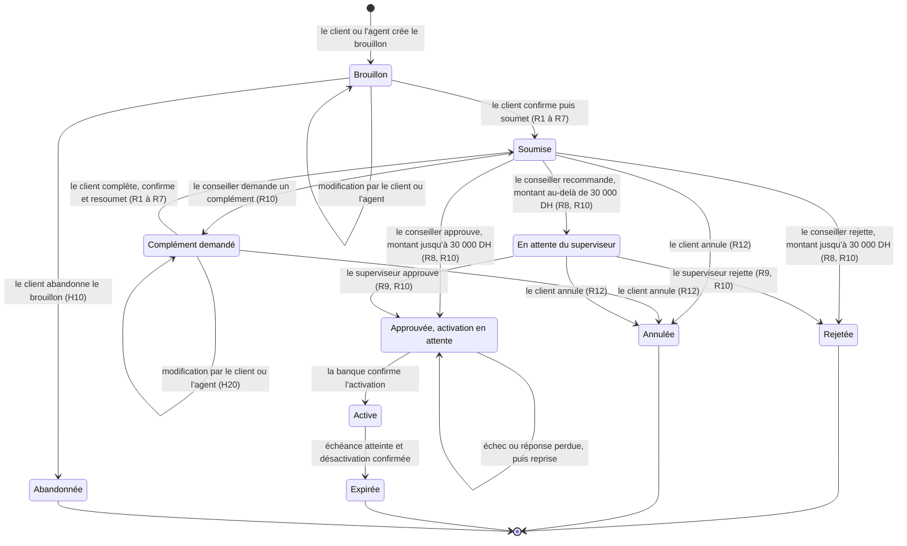
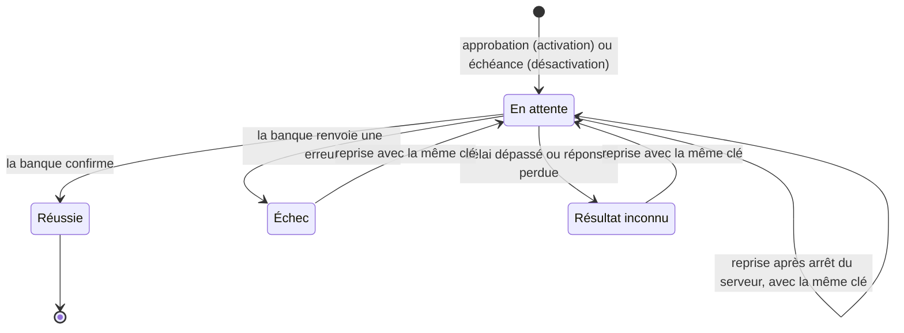

# États et transitions

Ce document décrit le cycle de vie d'une demande d'augmentation temporaire de plafond. Comme l'exige le cahier des charges, il distingue trois notions :

| Notion | Ce qu'elle représente | Où elle est stockée |
|---|---|---|
| **État métier** | Où en est le dossier dans le processus | Colonne `statut` de la demande |
| **Décision** | Un acte humain motivé (conseiller ou superviseur) | Table `decisions` |
| **Résultat d'exécution** | Ce qui s'est réellement passé dans la banque simulée | Colonnes `activation_statut` et `desactivation_statut` de la demande |

Exemple : une demande peut être **approuvée** (décision) sans que le plafond soit **actif** (exécution réussie). Le client voit la différence.

---

## 1. Catalogue des règles

Chaque règle porte un code, utilisé par les erreurs de l'API, l'agent IA et les tests.

| Code | Règle |
|---|---|
| **R1** | Le plafond demandé est un montant total, strictement supérieur au plafond initial (10 000 DH) et au plus égal à 100 000 DH. |
| **R2** | La durée est comprise entre 1 et 7 jours, à compter de la confirmation d'activation. |
| **R3** | Le motif de la demande est obligatoire. |
| **R4** | Au-delà de 50 000 DH, un justificatif fictif est obligatoire avant soumission ; seule sa présence est contrôlée. |
| **R5** | Un dossier client marqué incomplet empêche la soumission. L'agent peut expliquer le blocage, mais pas modifier ce statut. |
| **R6** | Un compte ne peut avoir qu'une demande en cours ou un plafond temporaire actif, même en cas de soumissions simultanées. |
| **R7** | La soumission exige une confirmation explicite du client : il renvoie le montant et la durée qu'il a vus, ainsi que la version du dossier, transmise sans être affichée. Si l'un d'eux a changé, la confirmation est refusée et doit être renouvelée. Une conversation seule ne vaut pas confirmation. |
| **R8** | Jusqu'à 30 000 DH inclus : décision du conseiller. Au-delà : recommandation du conseiller, puis décision obligatoire du superviseur. |
| **R9** | La personne qui a recommandé une demande ne peut pas la valider comme superviseur, même si elle possède plusieurs rôles. |
| **R10** | Toute décision humaine comporte un motif. |
| **R11** | Une action fondée sur une version périmée est refusée (HTTP 409) ; l'utilisateur doit relire le dossier. |
| **R12** | Le client peut annuler uniquement avant la première décision d'approbation ou de rejet. |
| **R13** | Aucune activation n'est possible hors de l'état « Approuvée » : ni pendant un complément, ni après un rejet ou une annulation. |
| **R14** | Périmètre : un client ne voit que ses comptes et dossiers ; un conseiller, ceux de son portefeuille ; un superviseur, ceux transmis à son équipe. Ces contrôles s'appliquent aussi aux outils de l'agent. |

---

## 2. Diagramme des états métier

**Lecture des parcours demandés par le cahier des charges**

| Parcours | Chemin |
|---|---|
| Normal (jusqu'à 30 000 DH) | Brouillon → Soumise → Approuvée → Active → Expirée |
| Normal (au-delà de 30 000 DH) | Brouillon → Soumise → En attente du superviseur → Approuvée → Active → Expirée |
| Boucle de complément | Soumise → Complément demandé → Soumise (autant de fois que nécessaire) |
| Rejet | Soumise → Rejetée, ou En attente du superviseur → Rejetée |
| Annulation | Soumise, Complément demandé ou En attente du superviseur → Annulée |
| Échec d'activation | Approuvée → Approuvée (reprise) → Active |
| Expiration | Active → Expirée |

**États finaux :** Rejetée, Annulée, Expirée et Abandonnée n'ont aucune transition sortante.

---

## 3. Diagramme des résultats d'exécution

Le même cycle s'applique à l'**activation** (colonne `activation_statut`) et à la **désactivation** (colonne `desactivation_statut`). Chaque opération utilise une **clé d'idempotence fixe**, dérivée du dossier : `act-<id>` pour l'activation, `desact-<id>` pour la désactivation. Une reprise réutilise donc toujours la même clé.

**Pourquoi la reprise ne crée jamais de double activation :** la banque simulée mémorise les clés déjà traitées. Si l'opération a déjà été appliquée (cas de la réponse perdue), un nouvel appel avec la même clé renvoie le résultat d'origine sans rien appliquer à nouveau (H16). La reprise est donc sans danger depuis Échec, Résultat inconnu ou En attente, même si un appel précédent est encore en cours (H15).

**Couplage avec l'état métier**

| Événement | Effet sur la demande |
|---|---|
| Approbation | Dans une seule transaction : statut Approuvée, `activation_statut` En attente, décision et événement. L'appel à la banque est fait juste après la validation de cette transaction, de façon synchrone, avec un délai de 3 s (H15). |
| Activation **réussie** | Approuvée → Active ; `activation_statut` Réussie ; date d'activation (date d'application enregistrée par la banque, H17) et échéance (activation + durée × 24 h). La mise à jour n'a lieu que si la demande est encore Approuvée : deux reprises simultanées ne l'appliquent qu'une fois. |
| Activation **échouée** ou **inconnue** | La demande reste Approuvée ; `activation_statut` passe à Échec ou Résultat inconnu, avec l'erreur. Le dossier affiche cet état exact, et le bouton « Relancer » permet la reprise. Cette écriture n'a lieu que si la demande est **encore Approuvée** : un échec arrivé en retard n'écrase jamais une activation réussie entre-temps par une reprise. |
| Arrêt du serveur entre l'approbation et l'appel | `activation_statut` reste En attente : la situation est visible, et le bouton « Relancer » permet la reprise. |
| Échéance atteinte (commande d'expiration, H22) | `desactivation_statut` En attente, puis appel à la banque avec la clé `desact-<id>`. La demande reste Active tant que la désactivation n'a pas réussi. |
| Désactivation **réussie** | Active → Expirée ; le plafond initial est rétabli dans la simulation. |
| Désactivation **échouée** ou **inconnue** | La demande reste Active ; la commande d'expiration suivante reprend l'opération avec la même clé. Cette écriture n'a lieu que si la demande est **encore Active**. |

---

## 4. Décisions

| Type de décision | Acteur | Transition déclenchée |
|---|---|---|
| Demande de complément | Conseiller | Soumise → Complément demandé |
| Approbation | Conseiller (jusqu'à 30 000 DH) ou superviseur | Soumise ou En attente du superviseur → Approuvée |
| Rejet | Conseiller (jusqu'à 30 000 DH) ou superviseur | Soumise ou En attente du superviseur → Rejetée |
| Recommandation favorable ou défavorable | Conseiller (au-delà de 30 000 DH) | Soumise → En attente du superviseur |

Chaque décision enregistre : l'acteur, son rôle (déduit côté serveur, H18), le type, le motif, la **version** du dossier sur laquelle elle porte, le numéro de révision et la date.

---

## 5. Règles transversales

- **Version :** chaque changement d'**état métier** ou du **contenu de la demande** (montant, durée, motif ou justificatif, modifiables en Brouillon et en Complément demandé) incrémente la colonne `version`. Toute action humaine envoie la version qu'elle a lue ; si elle ne correspond plus, l'action est refusée (R11). Un changement du seul résultat d'exécution ne modifie pas la version. Cette colonne est un compteur technique réservé au contrôle de concurrence, jamais affiché : la version métier montrée à l'utilisateur est le numéro de révision (H14).
- **Référence :** attribuée à la première soumission, dans la même transaction, à partir d'une séquence PostgreSQL ; elle ne change plus ensuite. Un brouillon n'a pas de référence (H13).
- **Avertissements du brouillon :** la vérification des règles de contenu renvoie la liste complète des erreurs. À la soumission, ces erreurs sont des refus ; sur un brouillon, ce sont des avertissements qui n'empêchent pas l'enregistrement. Un brouillon de 60 000 DH sans justificatif est donc enregistré avec l'avertissement R4, et sa soumission reste refusée tant que le justificatif manque (H23).
- **Confirmation (R7) :** la soumission n'est acceptée que si la demande a encore le montant et la durée affichés au client, et la version transmise avec eux (sans être affichée). Toute modification du contenu incrémentant la version, une confirmation ancienne ne peut jamais valider une autre opération.
- **Révision :** chaque soumission ou resoumission crée une révision du contenu (montant, durée, motif, justificatif). La référence du dossier reste la même ; les révisions antérieures et les motifs restent consultables.
- **Historique :** chaque transition et chaque décision écrivent un événement (acteur, action, date, référence, version, motif) **dans la même transaction** que le changement d'état.
- **Demande « en cours » (R6) :** les états Soumise, Complément demandé, En attente du superviseur, Approuvée et Active. Un index unique partiel sur le compte, limité à ces états, garantit la règle même avec deux soumissions simultanées.

---

## 6. Ce que voit le client

| État métier | Libellé affiché au client |
|---|---|
| Brouillon | Brouillon, non soumis |
| Soumise | En cours d'examen |
| Complément demandé | Complément demandé : action requise |
| En attente du superviseur | En cours de validation |
| Approuvée, activation en attente | **Décision favorable, activation en cours** |
| Approuvée, activation en échec ou inconnue | **Décision favorable, plafond pas encore actif** |
| Active | **Plafond de X DH actif jusqu'au [date]** |
| Expirée | Plafond temporaire expiré, plafond initial rétabli |
| Rejetée | Demande rejetée (avec motif) |
| Annulée | Demande annulée |
| Abandonnée | Brouillon abandonné |

Le client voit les motifs de complément, d'approbation et de rejet, mais pas ceux des recommandations, qui restent internes à la banque (H19).

---

## 7. Hypothèses et ambiguïtés tranchées

Le cahier des charges autorise à questionner une ambiguïté et à proposer une réponse argumentée. Voici les choix retenus.

| # | Question | Choix retenu | Argument |
|---|---|---|---|
| H1 | Un brouillon compte-t-il comme « demande en cours » (R6) ? | Non. R6 s'applique à partir de la soumission. Un seul brouillon ouvert par compte, réutilisé par l'agent. | Une soumission incomplète « ne devient pas un dossier à traiter ». Le brouillon unique empêche aussi qu'un appel répété de l'agent crée deux brouillons. |
| H2 | Au-delà de 30 000 DH, le conseiller peut-il rejeter seul ? | Non. Il transmet une recommandation, favorable ou défavorable, et le superviseur décide. | Le cahier impose une décision obligatoire du superviseur au-delà de ce seuil, sans distinguer approbation et rejet : c'est l'interprétation la plus prudente. |
| H3 | Le client peut-il annuler une demande en attente du superviseur ? | Oui. | Une recommandation n'est ni une approbation ni un rejet ; l'annulation reste possible jusqu'à la première de ces décisions (R12). |
| H4 | Le niveau de validation dépend-il du montant initial ou du montant après complément ? | Du montant de la révision en cours au moment de la décision. | Le client peut modifier ses paramètres lors d'un complément ; la décision doit porter sur ce qui est réellement demandé. |
| H5 | Le superviseur peut-il demander un complément ? | Non. Il approuve ou rejette, avec un motif. | Le cahier limite son rôle à l'approbation ou au rejet d'une demande transmise. |
| H6 | Quand une demande est-elle « Expirée » ? | Lorsque la désactivation est confirmée par la banque simulée. | L'état affiché doit refléter la réalité : tant que le plafond n'est pas rétabli, il est toujours actif. |
| H7 | Le client peut-il modifier une demande soumise ? | Uniquement via le cycle de complément, à l'initiative du conseiller. | Le cahier interdit toute réécriture silencieuse d'un dossier en cours d'examen. |
| H8 | Comment se calcule l'échéance ? | `date_echeance = date_activation + duree_jours × 24 h`, en UTC. Une durée de 3 jours court donc 72 heures à partir de la confirmation de l'activation. | La durée part de la confirmation d'activation ; une durée glissante évite l'ambiguïté de la « fin du troisième jour calendaire » et ne dépend pas d'un fuseau horaire. |
| H9 | Qui garde un dossier si le client change de conseiller pendant l'examen ? | Le conseiller et son équipe sont fixés à la première soumission et ne changent plus. La réaffectation explicite n'est pas couverte (limite connue). | L'examen n'est pas interrompu, la responsabilité reste claire, et l'historique reste cohérent avec les décisions déjà rendues. |
| H10 | Que devient un brouillon abandonné ? | Il passe à l'état final « Abandonnée » ; il n'est jamais supprimé. Le compte peut ensuite ouvrir un nouveau brouillon. | L'historique peut contenir des événements liés au brouillon (création par l'agent, par exemple) : le supprimer casserait la traçabilité. |
| H11 | Le plafond initial est-il le même pour tous les comptes ? | Oui : 10 000 DH, comme l'indique le cahier. | Le seuil de R1 s'exprime par rapport à ce plafond. |
| H12 | Qui peut relancer une activation ? | Le conseiller du dossier, ou le superviseur de l'équipe si le dossier lui a été transmis. | La reprise ne prend aucune décision nouvelle : elle rejoue une opération déjà approuvée, avec la même clé. Elle est tracée dans l'historique. |
| H13 | Quand la demande reçoit-elle sa référence ? | À la première soumission, dans la même transaction, à partir d'une séquence PostgreSQL (format `DEM-2026-000123`). La colonne est vide pour un brouillon ; les événements d'un brouillon sont rattachés par l'identifiant de la demande. | Le cahier indique que c'est la demande **soumise** qui reçoit une référence. Un brouillon abandonné ne consomme aucune référence. |
| H14 | Que désigne la « version » montrée à l'utilisateur ? | Le numéro de révision (`revision_no` : v1, v2…), qui est la version métier. La colonne `version` est un compteur technique réservé au contrôle de concurrence et n'est jamais affichée ; les formulaires et la carte de confirmation la transmettent sans l'afficher, ce qui permet à R7 et R11 de fonctionner. | Le cahier parle de « versions antérieures consultables » : ce sont les révisions. Le compteur technique augmente à chaque modification du brouillon et n'a pas de sens pour l'utilisateur. |
| H15 | Comment fonctionne la relance d'une activation ? | C'est une action utilisateur : le dossier est chargé avec le filtre de périmètre, l'action est tracée, mais elle est conditionnée au seul statut Approuvée, sans version. Elle est possible depuis Échec, Résultat inconnu ou En attente. L'appel bancaire est synchrone, avec un délai de 3 s, et la réponse indique le résultat. | Elle ne prend aucune décision nouvelle et rejoue l'opération avec la même clé : elle reste sans danger même si un autre appel est en cours. |
| H16 | Les modes `ECHEC` et `REPONSE_PERDUE` s'appliquent-ils à une reprise ? | Non. Ils ne s'appliquent qu'aux nouvelles clés ; une clé déjà connue renvoie toujours son résultat enregistré. | Sinon, une reprise ne pourrait jamais retrouver le résultat sans changer de mode (scénario 5). |
| H17 | Quelle date d'activation retenir après une réponse perdue ? | La date d'application enregistrée par la banque, et non la date à laquelle le système en reçoit la confirmation. | Le plafond est réellement actif depuis son application : l'échéance (H8) doit partir de cette date, sinon le plafond resterait actif plus longtemps que la durée demandée. |
| H18 | Sous quel rôle agit un utilisateur qui en possède plusieurs ? | Le rôle est déduit côté serveur de l'action et de l'état : une recommandation est faite comme conseiller, une décision sur une demande en attente du superviseur comme superviseur. Son périmètre est l'union des deux filtres. | `actor_role` est écrit par le serveur et ne vient jamais du client ; R9 reste vérifiée sur `recommender_id`. |
| H19 | Le client voit-il les motifs des recommandations ? | Non. Il voit les motifs de complément, d'approbation et de rejet. L'outil `consulter_dossier` applique le même filtre. | Une recommandation est un avis interne au superviseur, et non une décision rendue au client. L'agent n'a pas plus d'accès que l'écran client. |
| H20 | L'agent peut-il modifier un dossier en complément ? | Oui, comme le client : `preparer_brouillon` agit sur un brouillon ou sur un dossier en Complément demandé. Il relit la version côté serveur et ne la reçoit jamais du modèle. Si un brouillon existe déjà pour le compte, il le renvoie au lieu d'une erreur. | L'agent a les mêmes pouvoirs que le formulaire, pas plus. La confirmation (R7) protège la soumission si le formulaire et l'agent modifient le dossier en même temps. |
| H21 | Quel est le « plafond actuel » montré au client et à l'agent ? | Le plafond réellement appliqué par la banque (`bank_limits.plafond_courant`), avec l'indication qu'il s'agit d'un plafond temporaire le cas échéant. | Le client doit voir la réalité de l'exécution, pas une valeur théorique. |
| H22 | Comment la commande d'expiration gère-t-elle les dates ? | La commande reçoit deux dates distinctes : `dateSimulee` (la date passée à `--date`), qui sert uniquement à sélectionner les échéances, et `maintenant` (l'heure réelle), qui date les événements. `events.created_at` est toujours l'heure réelle ; la date simulée est enregistrée dans `details`. Une date simulée antérieure à l'heure réelle est refusée. | L'historique reste chronologique : une action réelle faite après la démonstration n'apparaît jamais avant l'expiration simulée. |
| H23 | Quel degré de proactivité pour l'agent ? | L'agent prévient dès le début si le dossier est incomplet (R5) ou si une demande est déjà en cours sur le compte (R6, via `consulter_comptes`). Après chaque enregistrement du brouillon, il suit la liste des avertissements renvoyée par `preparer_brouillon` pour demander les précisions manquantes. Il propose des options, mais ne modifie jamais le brouillon sans une réponse explicite du client. | Le cahier laisse le candidat choisir le degré de proactivité. Prévenir tôt évite au client de découvrir un blocage au moment de soumettre. Les avertissements viennent des mêmes règles que les refus, et non du modèle. Le client garde la main sur chaque modification, et la carte de confirmation (R7) reste la garantie finale. |

---

## 8. Limites connues

- **Réaffectation d'un dossier** : non couverte (H9).
- **Demande bloquée en Approuvée** : si l'activation échoue à chaque reprise, la demande reste Approuvée sans autre issue. Le client ne peut plus l'annuler (R12) et le compte reste bloqué par R6. La résolution se fait hors de l'application. Ce cas est volontairement laissé de côté, comme le worker de reprise automatique.
- **Numérotation des références** : une séquence PostgreSQL n'est pas annulée avec la transaction. Une soumission refusée peut donc laisser un trou dans la numérotation ; l'unicité n'est pas affectée.
