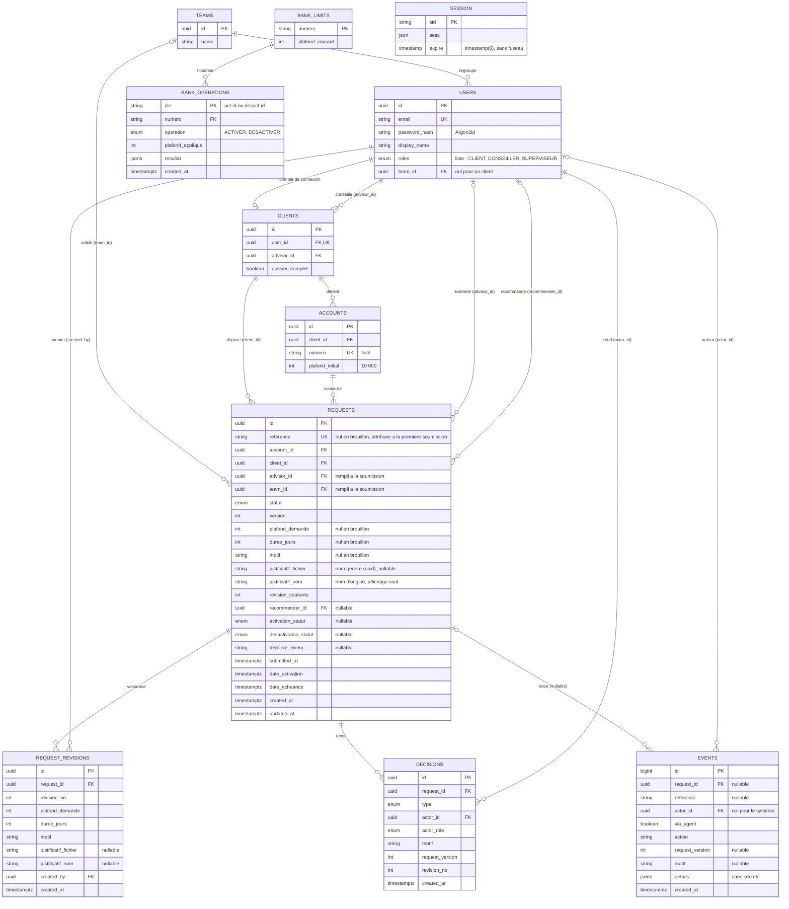

# Modèle de données

Ce document décrit les tables PostgreSQL du projet et la façon dont elles garantissent les règles critiques. Il découle directement de `etats-transitions.md`.

**Conventions**
- Identifiants en `uuid` ; dates en `timestamptz` (UTC).
- Montants en **dirhams entiers** (`integer`) : les règles ne portent que sur des dirhams entiers, et un entier évite toute erreur d'arrondi. Un montant décimal est refusé par la validation des entrées.
- **Aucune demande n'est supprimée.** Un brouillon abandonné passe à l'état final `ABANDONNEE` (H10), ce qui préserve l'historique. **Aucun justificatif n'est supprimé** non plus : les révisions y font référence.
- **La date courante est passée en paramètre aux services** (`maintenant`) : l'heure réelle pour les actions des utilisateurs. La commande d'expiration reçoit deux dates distinctes : `dateSimulee` (la date passée à `--date`, jamais antérieure à l'heure réelle), qui sert uniquement à sélectionner les échéances, et `maintenant` (l'heure réelle), qui date les événements. `events.created_at` est donc toujours l'heure réelle, et la date simulée est enregistrée dans `details`. Dater les événements de la date simulée créerait des événements datés dans le futur, et une action réelle faite ensuite apparaîtrait avant eux dans l'historique (H22).
- Les transactions utilisent le niveau d'isolation par défaut de PostgreSQL, `READ COMMITTED`. Les mises à jour conditionnelles de la section 4 reposent sur son comportement.
- **Accès en SQL brut** avec le pilote `pg` : requêtes toujours paramétrées (`$1`, `$2`…), jamais construites en concaténant du texte. Une interface TypeScript par table ; les fonctions d'accès convertissent les lignes (colonnes en `snake_case`) vers ces interfaces. `updated_at` est écrit explicitement dans chaque `UPDATE` (avec `maintenant`). Le schéma est créé par des migrations SQL numérotées (§ 8).

---

## 1. Vue d'ensemble

Dix tables, plus la table de session utilisée par `connect-pg-simple` (créée par la migration initiale) et la table technique `schema_migrations` du script de migration (§ 8). Le diagramme reprend toutes les tables, toutes leurs colonnes et toutes leurs clés étrangères.



---

## 2. Tables

### Utilisateurs et périmètres

| Table | Colonnes principales | Rôle |
|---|---|---|
| `users` | `id`, `email` (unique), `password_hash` (Argon2id), `display_name`, `roles` (liste : `CLIENT`, `CONSEILLER`, `SUPERVISEUR`), `team_id` (nul pour un client) | Comptes de connexion. La liste de rôles permet à un même utilisateur d'être conseiller et superviseur, ce qui sert à tester R9. |
| `teams` | `id`, `name` | L'équipe d'un superviseur et de ses conseillers. |
| `clients` | `id`, `user_id` (unique), `advisor_id`, `dossier_complet` | Le dossier client. `advisor_id` définit le **portefeuille** du conseiller ; `dossier_complet` porte R5. |
| `accounts` | `id`, `client_id`, `numero` (unique, fictif), `plafond_initial` (10 000 DH) | Les comptes du client. |

### Demandes

| Table | Colonnes principales | Rôle |
|---|---|---|
| `requests` | `id`, `reference` (unique, nullable, ex. `DEM-2026-000123`), `account_id`, `client_id`, `advisor_id`, `team_id`, `statut`, `version`, `plafond_demande`, `duree_jours`, `motif`, `justificatif_fichier`, `justificatif_nom`, `revision_courante`, `recommender_id`, `activation_statut`, `desactivation_statut`, `derniere_erreur`, `submitted_at`, `date_activation`, `date_echeance`, `created_at`, `updated_at` | La demande, son **état métier** et le **résultat d'exécution** de l'opération bancaire en cours. `plafond_demande`, `duree_jours`, `motif` et le justificatif forment la copie de travail : nullables, car un brouillon peut être incomplet, et modifiables uniquement en Brouillon ou en Complément demandé. |
| `request_revisions` | `id`, `request_id`, `revision_no`, `plafond_demande`, `duree_jours`, `motif`, `justificatif_fichier`, `justificatif_nom`, `created_by`, `created_at` ; unique sur (`request_id`, `revision_no`) | Instantané créé à chaque soumission et resoumission : les versions antérieures restent consultables, comme l'exige le cahier. `revision_no` est la version métier, montrée à l'utilisateur (v1, v2…). La colonne `requests.version` est un compteur technique réservé au contrôle de concurrence, jamais affiché (H14). |
| `decisions` | `id`, `request_id`, `type`, `actor_id`, `actor_role`, `motif`, `request_version`, `revision_no`, `created_at` ; unique sur (`request_id`, `request_version`) | Les **décisions** humaines. Types : `DEMANDE_COMPLEMENT`, `APPROBATION`, `REJET`, `RECOMMANDATION_FAVORABLE`, `RECOMMANDATION_DEFAVORABLE`. |

**Valeurs des statuts**
- `statut` : `BROUILLON`, `SOUMISE`, `COMPLEMENT_DEMANDE`, `ATTENTE_SUPERVISEUR`, `APPROUVEE`, `ACTIVE`, `EXPIREE`, `REJETEE`, `ANNULEE`, `ABANDONNEE`.
- `activation_statut` et `desactivation_statut` : `EN_ATTENTE`, `REUSSIE`, `ECHEC`, `INCONNU`. Ils restent nuls tant que l'opération n'a pas commencé.

**Référence.** Elle est tirée d'une séquence PostgreSQL à la **première soumission**, dans la même transaction que la transition, puis ne change plus (H13). Elle est nulle pour un brouillon ; l'index unique de PostgreSQL accepte plusieurs valeurs nulles. Les événements d'un brouillon sont rattachés par `request_id`.

**Justificatif.** Le fichier est enregistré sur disque, hors du dossier public, sous un **nom généré par le serveur** (`justificatif_fichier` : un uuid suivi de l'extension correspondant au type validé). Le nom envoyé par le client n'est **jamais** utilisé pour construire un chemin : un nom comme `../../config.env` ne peut donc pas écrire en dehors du dossier prévu. Il est conservé à part (`justificatif_nom`), uniquement pour l'affichage. Les deux colonnes sont recopiées dans la révision au moment de la soumission. Le cahier précise que seule la présence du justificatif est contrôlée. Un justificatif remplacé lors d'un complément n'est **jamais supprimé** : la révision antérieure y fait toujours référence.

**Identifiants recopiés dans `requests`.** `client_id` est recopié depuis le compte à la création du brouillon. `advisor_id` et `team_id` sont fixés à la **première soumission**, à partir du conseiller du client et de son équipe, puis ne changent plus (H9). Ces copies permettent de filtrer le périmètre dans une seule requête, sans jointure (§ 5).

### Historique

| Table | Colonnes principales | Rôle |
|---|---|---|
| `events` | `id` (`bigserial`), `request_id` (nullable), `reference` (nullable), `actor_id` (nul pour le système), `via_agent`, `action`, `request_version`, `motif`, `details` (`jsonb`, sans secrets), `created_at` ; index sur (`request_id`, `created_at`) | L'**historique** exigé par le cahier : acteur, action, date, référence, version et motif. `actor_id` désigne toujours l'utilisateur pour qui l'action est faite, et `via_agent` indique si elle passe par l'agent : on lit « Amal, via l'agent ». `request_id` est nul pour les événements sans dossier, comme une consultation du plafond ou un refus d'accès. `reference` est nulle pour les événements d'un brouillon (H13). Pour la commande d'expiration, `created_at` est l'heure réelle et la date simulée figure dans `details` (H22). |
| `session` | `sid`, `sess`, `expire` ; index `IDX_session_expire` | Sessions serveur de `connect-pg-simple`. La table est créée par la migration `001_modele_initial.sql`, avec exactement la structure du fichier `table.sql` de `connect-pg-simple` : c'est pourquoi `expire` est un `timestamp(6)` sans fuseau, seule exception à la convention `timestamptz`. À l'étape de l'authentification, l'option `createTableIfMissing` de `connect-pg-simple` restera désactivée : l'application ne crée jamais de table. |

### Banque simulée

| Table | Colonnes principales | Rôle |
|---|---|---|
| `bank_limits` | `numero` (clé primaire), `plafond_courant` | Le plafond réellement appliqué « côté banque ». |
| `bank_operations` | `cle` (clé primaire), `numero`, `operation`, `plafond_applique`, `resultat` (`jsonb`), `created_at` | Mémoire des opérations déjà traitées. |

Le lien avec l'application est **logique, sans clé étrangère** : la clé transmise est `act-<id du dossier>` ou `desact-<id du dossier>`, et `numero` désigne le compte. C'est la frontière entre les deux systèmes.

---

## 3. Fonctionnement de la banque simulée

1. Si la clé existe déjà dans `bank_operations`, le résultat enregistré est renvoyé tel quel, sans rien appliquer, **quel que soit le mode** (H16).
2. Sinon, l'insertion dans `bank_operations` et la mise à jour de `bank_limits` sont faites **dans une seule transaction**. Deux appels simultanés avec la même clé : le second échoue sur la clé primaire et relit le résultat du premier.
3. Le `resultat` enregistré contient la **date d'application** de l'opération. C'est elle qui devient `date_activation` (H17), y compris quand la confirmation n'arrive qu'à la reprise.

L'application appelle la banque de façon synchrone, avec un délai de 3 s (H15).

| Mode | Comportement |
|---|---|
| `SUCCES` | La transaction est validée et le résultat est renvoyé. |
| `ECHEC` | Rien n'est écrit et une erreur est renvoyée : la reprise appliquera l'opération. |
| `REPONSE_PERDUE` | La transaction est **validée**, puis l'appelant reçoit un délai dépassé. Comme l'opération est enregistrée avec sa clé, la reprise retrouve le résultat d'origine au lieu de l'appliquer une seconde fois. |

Les modes `ECHEC` et `REPONSE_PERDUE` ne s'appliquent qu'aux **nouvelles** clés (étape 2) ; une clé déjà connue renvoie toujours son résultat enregistré (étape 1), sinon la reprise du scénario 5 ne pourrait pas aboutir.

Le mode est défini par la variable d'environnement `BANK_MODE` (`SUCCES` par défaut) et peut être changé pendant la démonstration par la route `POST /api/demo/banque/mode`. Les routes `/api/demo/...` n'existent que si `DEMO_MODE=true` (activé dans Docker Compose, à `false` par défaut dans les tests) et sont réservées aux conseillers et aux superviseurs.

---

## 4. Ce qui garantit les règles critiques

| Garantie | Mécanisme | Scénario du cahier |
|---|---|---|
| **R6** — une seule demande en cours par compte | Index unique partiel sur `requests(account_id)`, limité aux statuts `SOUMISE`, `COMPLEMENT_DEMANDE`, `ATTENTE_SUPERVISEUR`, `APPROUVEE`, `ACTIVE`. Une violation (erreur PostgreSQL `23505`) devient un HTTP 409. | Deux soumissions concurrentes ne créent qu'une demande en cours. |
| **H1** — un seul brouillon par compte | Index unique partiel sur `requests(account_id)`, limité au statut `BROUILLON`. | Une répétition d'appel de l'agent ne crée pas deux demandes. |
| **R7** — confirmation liée aux paramètres | Soumission par mise à jour conditionnelle sur le montant et la durée affichés, et sur la version transmise sans être affichée (§ 4.1). | Un double clic ou une confirmation ancienne est refusé. |
| **R11** — version périmée refusée | Chaque transition est une mise à jour conditionnelle sur la version lue ; 0 ligne modifiée = HTTP 409 (§ 4.2). | Une action depuis un écran ancien est refusée. |
| Une seule décision par version | Unique sur `decisions (request_id, request_version)`. | Deux décisions sur la même version ne produisent pas de résultats contradictoires. |
| Pas de double activation | Clé fixe par dossier et par opération ; clé primaire de `bank_operations` ; transaction côté banque (§ 3) ; passage à Active conditionné au statut Approuvée (§ 4.3). | Une reprise aboutit à une seule activation. |
| Périmètres (R14) | Filtre dans chaque requête SQL ; 404 hors périmètre (§ 5). | L'accès au dossier d'un autre client est refusé. |
| Cohérence état + historique | Transition, décision et événement écrits dans **une seule transaction**. | Le dossier peut toujours être reconstitué. |

Les règles de contenu (R1 à R5, R8 à R10) sont vérifiées par le domaine avant toute écriture, et couvertes par des tests unitaires. R12 et R13 sont portées par la table des transitions du domaine, testée de la même façon. Les garanties de ce tableau qui reposent sur la base (R6, R7, R11, R14) sont couvertes par des tests d'API.

**Déclaration des index partiels et de la séquence (migration `001_modele_initial.sql`)**

```sql
-- R6 : une seule demande en cours par compte.
CREATE UNIQUE INDEX uq_demande_en_cours ON requests (account_id)
  WHERE statut IN ('SOUMISE', 'COMPLEMENT_DEMANDE', 'ATTENTE_SUPERVISEUR', 'APPROUVEE', 'ACTIVE');

-- H1 : un seul brouillon par compte.
CREATE UNIQUE INDEX uq_brouillon_unique ON requests (account_id)
  WHERE statut = 'BROUILLON';

-- H13 : numéro des références, tiré à la première soumission. Une seule séquence, jamais remise à zéro.
CREATE SEQUENCE demande_reference_seq;
```

### 4.1 Soumission confirmée (R7)

La soumission n'est acceptée que si la demande a encore **le montant et la durée** que le client a vus, et **la version** que le formulaire ou la carte de confirmation a transmise sans l'afficher. Le contrôle et le changement d'état tiennent en une seule mise à jour conditionnelle :

```ts
// tx : la connexion fournie par la fonction de transaction.
const { rowCount } = await tx.query(
  `UPDATE requests
      SET statut = 'SOUMISE', version = version + 1, submitted_at = $6, updated_at = $6 -- …
    WHERE id = $1
      AND client_id = $2                                -- périmètre
      AND statut IN ('BROUILLON', 'COMPLEMENT_DEMANDE')
      AND version = $3                                  -- version transmise, non affichée
      AND plafond_demande = $4                          -- montant affiché
      AND duree_jours = $5`,                            // durée affichée
  [demandeId, session.clientId, confirmation.version, confirmation.plafond, confirmation.duree, maintenant],
);
if (rowCount !== 1) throw new ConfirmationARenouvelerError(); // HTTP 409
```

La révision et l'événement sont écrits dans la même transaction. À la première soumission, la référence est tirée de la séquence dans cette même transaction (H13). Toute modification du contenu, en brouillon comme pendant un complément, incrémente la version : une confirmation ancienne ne peut donc pas valider une autre opération. En cas de double clic, la seconde requête trouve une version déjà changée et ne modifie rien.

### 4.2 Décisions concurrentes (R11)

Chaque décision suit le même principe : mise à jour conditionnelle sur l'identifiant, la version lue et le statut attendu, puis vérification qu'une ligne a été modifiée. Si deux acteurs agissent en même temps sur la même version, PostgreSQL fait attendre le second ; celui-ci réévalue la condition après la validation du premier, ne modifie aucune ligne et reçoit un HTTP 409. L'unicité de `decisions (request_id, request_version)` garantit en plus qu'une seule décision peut porter sur une version donnée.

### 4.3 Activation et reprise

```ts
const { rowCount } = await tx.query(
  `UPDATE requests
      SET statut = 'ACTIVE', activation_statut = 'REUSSIE', version = version + 1,
          date_activation = $2,                         -- H17 : date enregistrée par la banque
          date_echeance = $3,                           -- H8
          updated_at = $4
    WHERE id = $1 AND statut = 'APPROUVEE'`,
  [demandeId, resultat.appliqueLe, ajouterHeures(resultat.appliqueLe, duree * 24), maintenant],
);
// rowCount = 0 : une autre reprise a déjà activé le plafond, rien à faire
```

L'appel à la banque utilise toujours la clé `act-<id du dossier>`. Le bouton « Relancer » rejoue l'appel avec cette même clé : même en cas de double clic, la banque n'applique l'opération qu'une fois, et la demande ne passe à Active qu'une fois.

**Un échec tardif n'écrase jamais un succès.** L'enregistrement d'un échec porte la même condition que celui d'un succès :

```ts
await tx.query(
  `UPDATE requests
      SET activation_statut = 'INCONNU', derniere_erreur = $2, updated_at = $3
    WHERE id = $1 AND statut = 'APPROUVEE'             -- comme pour le succès
  `,
  [demandeId, message, maintenant],
);
```

Exemple : l'appel d'origine attend une réponse perdue, une reprise réussit entre-temps et la demande passe à Active. Quand l'appel d'origine expire, la demande n'est plus Approuvée : rien n'est modifié, et l'écran reste exact. La désactivation suit la même règle, avec la condition `statut = 'ACTIVE'`.

---

## 5. Contrôle des périmètres (R14)

| Rôle | Dossiers accessibles |
|---|---|
| Client | `requests.client_id` = client de la session. |
| Conseiller | `requests.advisor_id` = utilisateur de la session (portefeuille). |
| Superviseur | `requests.team_id` = équipe de la session **et** `requests.recommender_id` non nul (dossier transmis). |
| Conseiller et superviseur | Union des deux filtres précédents. Le rôle sous lequel l'action est faite est déduit côté serveur de l'action et de l'état (H18). |

Le filtre est ajouté **dans la requête SQL elle-même** : un dossier hors périmètre n'est jamais chargé, et l'API renvoie 404, sans révéler son existence. Les outils de l'agent passent par les mêmes requêtes.

**R9** est vérifiée avant toute décision du superviseur : son identifiant est comparé à `requests.recommender_id`. Un test couvre l'utilisateur qui possède les deux rôles.

---

## 6. Mémoire de l'agent IA

Les conversations ne sont pas enregistrées dans les tables métier. Les derniers échanges sont conservés temporairement dans la session, stockée dans PostgreSQL par `connect-pg-simple`, et supprimés à son expiration ou à la déconnexion. Seuls les appels d'outils, leurs paramètres utiles et leurs résultats sont tracés durablement dans `events`, sans secrets.

---

## 7. Jeu de données de démonstration

| Compte | Rôles | Particularité | Sert à tester |
|---|---|---|---|
| `client.amal` | Client | Dossier complet, un compte à 10 000 DH | Parcours normal (25 000 DH, 3 jours) |
| `client.youssef` | Client | Dossier complet, un compte à 10 000 DH | Parcours à 60 000 DH avec justificatif, complément et superviseur |
| `client.sara` | Client | Dossier **incomplet** | Blocage de soumission (R5) |
| `client.hamid` | Client | Dossier complet, un compte à 10 000 DH | Demande recommandée par un utilisateur à double rôle (R9) |
| `client.ines` | Client | Dossier complet ; demande de 45 000 DH déjà recommandée, en attente du superviseur de l'équipe B | Cloisonnement entre équipes (R14) |
| `client.mehdi` | Client | Dossier complet ; demande de 40 000 DH déjà soumise, en attente d'examen par Karim | Scénario 3 : si Karim tente d'approuver cette demande, il est refusé (403, R8) |
| `conseiller.karim` | Conseiller | Portefeuille : Amal, Sara, Mehdi ; équipe A | Décisions jusqu'à 30 000 DH ; refus (403, R8) quand il tente d'approuver la demande de 40 000 DH de Mehdi |
| `conseiller.nadia` | Conseiller | Portefeuille : Youssef ; équipe A | Complément et recommandation au-delà de 30 000 DH |
| `conseiller.salma` | Conseiller | Portefeuille : Inès ; **équipe B** | Auteure de la recommandation d'Inès |
| `superviseur.omar` | Superviseur | Équipe A | Décision sur les demandes transmises ; reçoit **404** sur le dossier d'Inès |
| `superviseur.rachid` | Superviseur | **Équipe B** | Seul superviseur à voir et traiter le dossier d'Inès |
| `mixte.leila` | Conseiller **et** superviseur | Portefeuille : Hamid ; équipe A | R9 : ne peut pas valider ce qu'elle a recommandé |

Le jeu de données est créé **par les services métier**, et non par des insertions directes : la demande d'Inès suit le vrai parcours (brouillon, confirmation, soumission, recommandation), comme celle de Mehdi (brouillon, confirmation, soumission). Son historique est donc identique à celui d'une demande créée dans l'application.

Toutes les identités, tous les comptes et tous les mots de passe sont fictifs. Les identifiants de connexion sont documentés dans le README.

---

## 8. Accès aux données et migrations

**Accès aux données.** Le pilote `pg` est utilisé directement, sans ORM :
- Un **pool de connexions**, créé dans un service NestJS et fermé à l'arrêt de l'application.
- Une **fonction de transaction** : elle prend une connexion du pool, exécute `BEGIN`, appelle le code fourni avec cette connexion (`tx`), puis `COMMIT` ; en cas d'erreur, `ROLLBACK`, et l'erreur est relancée. La connexion est toujours rendue au pool. Toutes les requêtes d'une transaction passent par `tx`, jamais par le pool.
- **Requêtes toujours paramétrées** (`$1`, `$2`…). Aucune requête n'est construite en concaténant du texte ; les noms de tables et de colonnes sont écrits en dur.
- **Une interface TypeScript par table** (par exemple `Demande` pour `requests`). Les fonctions d'accès convertissent chaque ligne (`plafond_demande`) vers l'interface (`plafondDemande`) : le reste du code ne manipule jamais une ligne brute. `pg` renvoie un `bigint` sous forme de texte : `events.id` est converti explicitement.
- Une violation d'unicité est reconnue par le code d'erreur PostgreSQL **`23505`** et le nom de la contrainte (`uq_demande_en_cours`, `uq_brouillon_unique`…).

**Migrations.** Des fichiers SQL numérotés dans `api/migrations/` : `001_modele_initial.sql`, `002_….sql`… Un fichier appliqué n'est jamais modifié : toute évolution passe par un nouveau fichier.

Le script `npm run migrate` (code compilé) :
1. crée la table `schema_migrations` (`nom` en clé primaire, `appliquee_le`) si elle n'existe pas ;
2. lit les fichiers de `api/migrations/` dans l'ordre de leur numéro ;
3. pour chaque fichier absent de `schema_migrations`, exécute son contenu **et** l'enregistre dans `schema_migrations`, dans une même transaction : une migration est appliquée entièrement ou pas du tout.

Le même script sert en local, dans Docker (au démarrage du conteneur) et dans la CI. Il n'ajoute aucune dépendance.
